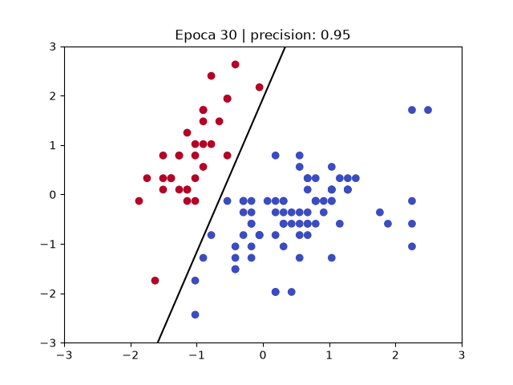

# Perceptrón con Iris

Clasificador Binario que distingue la Flor **Iris Setosa** de las otras dos especies de Iris (Iris Versicolor e Iris Virginica) utilizando un perceptrón simple.

# Qué hace 
1. Carga el  dateset Iris y se queda con el largo y el ancho del sépalo.
2. Normaliza los datos son `StandarScaler`.
3. Entrena un `Perceptron` con `partial_fit`, una época a la vez.
4. Dibuja la línea que separa  Setosa del resto después de cada época.

## Cómo ejecutarlo

```
python -m venv venv 
venv\Scrips\activate
pip install numpy scikit-learn matplotlib
python perceptron.py
```



# Qué aprendi

- Un perceptrón calcula una suma ponderada más un sesgo y aplica un umbral.
- La frontera de una decisión es una línea recta, por eso solo funciona con clases separables linealmente.
- `partial_fit` permite ver el aprendizaje paso a paso, en vez de entrenar todo de golpe.

### Cambios respecto al original
- corregí la etiqueta de la predicción: en este código la clase 1 es Setosa.
- Usé un punto de prueba dentro del rango real del dataset.
- Agregué la animación del entrenamiento con matplotlib.

## Crédito

Baasado en un video  de Youtube Shorts de @Laboratoriodecódigos.